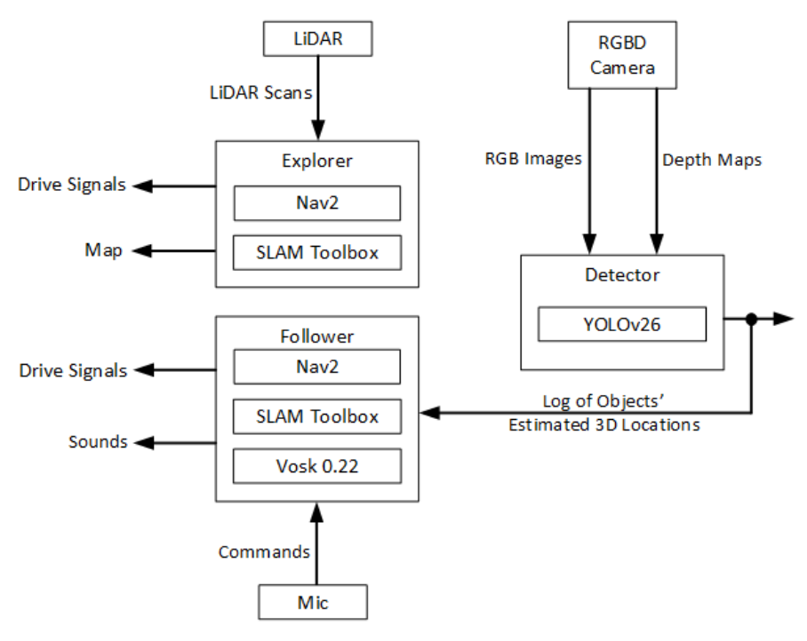
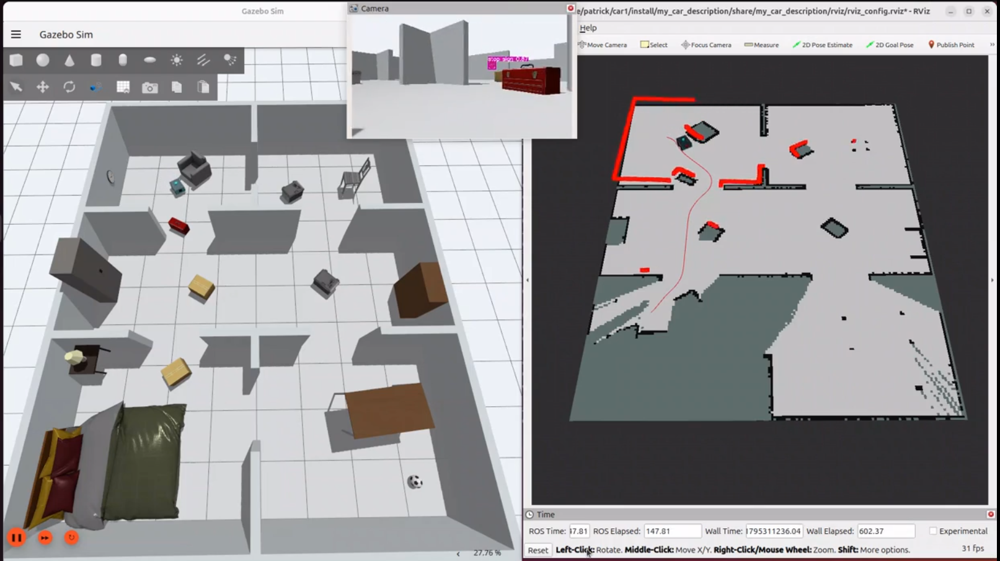
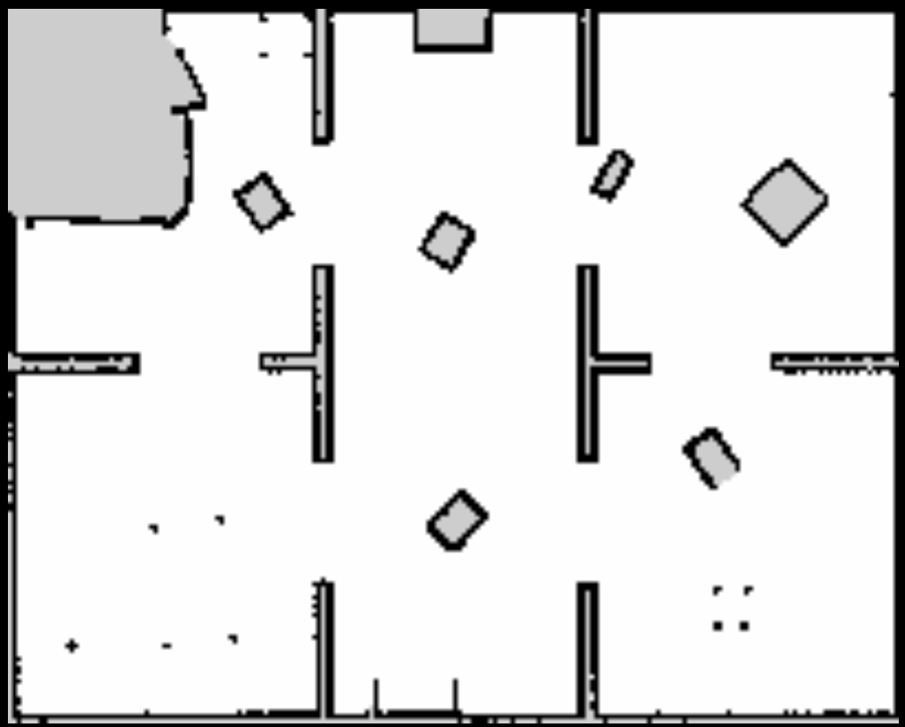
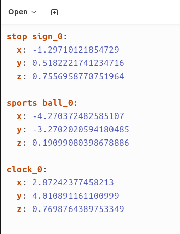

# PatBot: Voice-Controllable SLAM-based Autonomous Robot with Object Detection Ability
PatBot is an autonomous robot that maps an environment and estimates 3D locations of objects in the environment. After PatBot maps the environment entirely, users can command it to reach a target object in the environment or a spot close to the target object. While navigating, PatBot avoids obstacles and finds shortest path to target. 
## 1. VIDEO DEMO

  

## 2. POTENTIAL APPLICATIONS
* PatBot can be used for infrastructure inspection without human supervision, because it can autonomously navigate an infrastructure or environment and estimate the locations of the damages to the infrastructure (e.g., cracks, rusts, etc.) while avoiding obstacles. This is useful when it comes to inspection of an infrastructure or environment that is challenging or risky for human to do (e.g., sewers, mining site, etc.).
* PatBot can also be used for search and rescue because, while avoiding obstacles, it can create a map for an unknown region, find a target, estimate and remember the target’s location, and guide rescuers to the location of the target. 
* PatBot is fully autonomous and voice-controllable. Users can interact with it hand-free. 
## 3. NOTABLE FEATURES AND TECHNOLOGIES
* Backbone: ROS 2, Python.
* Simultaneous Localization and Mapping: SLAM Toolbox.
* Autonomous Navigation: Nav2. 
* Object detection and location estimation: YOLOv26.
* Voice recognition: Vosk 0.22. 
## 4. OVERALL ARCHITECTURE
* PatBot has 3 main systems: Explorer, Follower, and Detector. The overall operation flow of PatBot and how the systems interact with one another are shown below. In general, PatBot has two phases: (i) mapping and detecting and (ii) voice-controlled following.

 

## 5. OPERATION FLOW
### Mapping and Detecting
* In an unknown environment, Explorer receives 2D LiDAR scans from LiDAR sensor and determines which areas are unknown (undefined), free, or occupied. Explorer then identifies frontier positions (defined below) in the environment and drives PatBot to move to those positions. While PatBot moves, Explorer perceives the environment using LiDAR and get more knowledge about the environment. The accumulated knowledge will later be used to generate a map of the environment. 
* Detector receives RGB images and depth maps of the surroundings from the RGBD camera. While PatBot moves, Detector detects objects in the environment, estimates their 3D locations (x, y, z), and records detected objects in a log when the detection confidence is at least 80%. In the log, objects of the same type are indexed starting from 0 (e.g., ball 0, ball 1,...)
* After PatBot moves for a while, when determining that the environment no longer has unknown areas, Explorer stops the navigation and outputs a map containing object in the environment and their boundaries for users to review. Users can also see the 3D locations of objects in the environment from the log mentioned above. PatBot will notify users after the map is complete.
### Voice Recognition and Following
* After the map is generated, Follower is ready for voice commands. Follower listens, via a mic, to wake word “listen Patrick” to trigger its command-listening process. After detecting the wake word, Follower will listen to voice command from users via the mic. 
* A valid command has a format of Action + Object + Object Index (e.g., move to clock zero). When a command is valid, Follower recognizes a target object that users want PatBot to move to, retrieve the object’s 3D location from the log, and responds to users with “Okay” to acknowledge the command. Follower then drives PatBot to the location of the target object, or a spot close to the target object, depending on where the target object is and whether the path to the target object is traversable. 
* When a command is invalid, Follower tells users that the command is invalid and performs no action until users wake PatBot up with wake word.
---
Now, let’s dive into the details of each system
---
## 6. EXPLORER
* Explorer is implemented with [Nav2](https://docs.nav2.org/rolling/) and [SLAM Toolbox](https://github.com/SteveMacenski/slam_toolbox) frameworks. In short: 
  * SLAM Toolbox takes in LiDAR scans and PatBot’s odometry transform to estimate robot’s pose, and publish a 2D occupancy grid representing unknown, free, and occupied spaces in the environment. 
  * Nav2 then uses the occupancy grid and adds obstacles and inflation costs to the grid to create a global costmap, then uses the global costmap to plan a path to a goal pose. 
  * Nav2 also uses robot’s pose estimate and LiDAR scans to create a local costmap around PatBot, then uses the local costmap to avoid nearby obstacles while following the planned path to the goal pose.  
* For PatBot to move autonomously, I implemented frontier-based exploration for Explorer:
  * Explorer first retrieves 2D occupancy grid, then finds all the frontier cells in the grid. A frontier cell is a free cell that borders at least one unknown cell in the occupancy grid. 
  * Explorer then groups frontier cells into clusters using BFS. A cluster should contain frontier cells that are connected to one another. 
  * Explorer filters out any cluster with less than 15 cells, because a cluster can be as small as having 1 cell, and w/o filtering, we will have a lot of clusters. In next step, we will compute centroid of each cluster; the less clusters there are, the fewer centroids Explorer needs to compute, thereby saving computing resources,
  * Explorer then computes centroid of each cluster. A centroid of a cluster can fall into an occupied or unknown cell, so Explorer picks a frontier cell in the cluster closest to the centroid as a representative for the cluster. The representatives of the clusters are candidate goal poses for Explorer to consider. 
  * Explorer then retrieves all paths between the location of PatBot and candidate goal poses using Nav2, then computes lengths of the paths. Explorer only chooses the candidate goal pose with the shortest path as the target goal pose for PatBot to move to. 
  * Explorer then sends the target goal pose to Nav2 so that Nav2 can drive PatBot to the target goal pose. 
* After PatBot traverses the entire environment and no unknown cells left in the occupancy grid, Nav2 creates a map of the environment in “.pgm” format based on the occupancy grid. 
## 7. DETECTOR
* Detector is implemented with [YOLOv26](https://docs.ultralytics.com/models/yolo26) image segmentation model.
* A 3D location of an object in a global frame (map frame) has coordinates (x, y, z). So, that object on an image frame should have coordinates of same format/dimension, e.g., (u, v, d). 
* Detector retrieves RGB images and depth maps from RGBD camera. Detector then converts the RGB images and depth maps into a suitable format and feed them to YOLO. 
* When YOLO detects an object in an RGB image with a confidence score over 80%, Detector then retrieves the depth data of image pixels that are masked as within the object by YOLO. 
* Detector then computes the median depth of the retrieved depth data, and finds coordinates (u, v) of the image pixel with the depth data closest to the median depth.The pixel then has the coordinates of (u, v, d), where u and v are coordinates of the pixel on the image and d is the depth of the pixel.This pixel is the representative of the object on the image. 
* Detector then transforms the coordinates (u, v, d) of the pixel to 3D camera frame using the camera intrinsic. Detector then transforms the coordinates of the pixel on the 3D camera frame to the global frame (map frame) using the transform between the camera and the map. The resulting 3D coordinate of the pixel is (x, y, z), which is the representative/estimated 3D location of the object in the map (environment).  
* While moving around, PatBot can see an object from different positions, so estimated locations of the object from different positions may vary slightly. To avoid double counting the same object when PatBot sees it from various positions, if two location estimates are within 30 cm of each other, then the Detector views the two estimates as representing the same object. If 2 estimates are outside 30 cm threshold, then Detector views them as representing two different objects. 
* Detector then logs the 3D location of the object in a yaml file, so the Follower can look at later. 
## 8. FOLLOWER
* Follower is implemented with [Vosk](https://alphacephei.com/vosk/models) 0.22-lgraph speech recognition model.
* Vosk first listens to the wake word/phrase “listen Patrick”. After Vosk detects the wake word from the user, it then listens to the voice command of users. 
* After Vosk is awaken, Follower says “huh” to let users know Vosk is listening to voice commands. After receiving a voice command, Follower verifies if the command is valid or the requested object to reach is present in the environment (in the yaml log).  
* Users are free to speak any types of commands, as long as the commands have the format (Action + Object + Object Index, in any order), the requested object is present in the yaml log, and there’s no negation (don’t, not) in the command. Actions include (move, proceed, head, go, jump, navigate, find, search, seek), indexes include 0-10, and objects include any types.
* If the command is valid and the requested object is present, Follower says “Okay” and sends the object’s pose to Nav2, so PatBot can move to the object safely. After reaching the object, Follower says ”Found the object. Yay!”, and Vosk starts listening to wake word again.
* If the command is invalid or the requested object is absent, Follower says “Invalid command” and laughs at users. Vosk then starts listening to wake word again.
---
Addition Information
---
## 9. POTENTIAL IMPROVEMENTS
* Use 3D LiDAR for better scanning and use Vox_Nav to take in 3D LiDAR scans and generate 3D map of an environment. 
* Allow PatBot to load an existing map and navigate an environment using the existing map, instead of re-navigating the environment even when there’s an existing map for the environment. Allow PatBot to check if the existing map is appropriate for the environment before using the map for navigating. 
* Highlight the objects and their locations right in the map of the environment for easier visual.
* Reduce the 30-cm threshold for two location estimates to be viewed as representing the same object. 30 cm is still a pretty large threshold.
## 10. IMAGE DEMO
* PatBot plans a path to navigate to an unknown space in an environment, follows the path, and detects object while moving. 

* PatBot creates a map of objects in the environment after exploring the entire environment.

 

* PatBot logs 3D locations of objects in the environment that YOLO detects with over 80% confidence.

 

